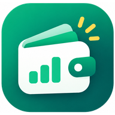

<p align="center"><br /></p>
<p align="center"><strong>Plan · Track · Save</strong></p>

# Budgify

A self-hosted budgeting app that connects to your bank accounts, shows **where your money is going**, and works out **where it needs to go** to hit your savings goals.

It runs on your own computer. Your transactions are stored in a local SQLite file, and the tokens for your bank connections are encrypted at rest.

## What it does

| Tab | What you get |
|---|---|
| **Overview** | Income, spending and what's left over for any month; spending by category against your budget and your typical month; a 6-month income-vs-spending trend; top merchants. |
| **Goals & plan** | Add goals (emergency fund, trip, down payment…) with a target and a date. The planner works out the monthly amount each goal needs, then funds them in priority order from your typical surplus. It flags goals that are on track, behind or unfunded and gives the finish date at your current pace. When you can't fund everything, it suggests cuts to discretionary spending only (never to needs like rent or groceries) that would close the gap. |
| **Transactions** | Search and filter, and fix a category in one click. Choose "apply to similar" and it saves a rule, so future transactions from that merchant are filed the same way. |
| **Budgets** | Monthly limits per category, shown next to your typical spending. |
| **Accounts** | Connect banks, sync, net worth, CSV import, demo data. |

## Quick start

Requires **Node.js 22.13+**. The app uses Node's built-in SQLite, so there are no native modules to compile.

```bash
npm install
npm start            # → http://127.0.0.1:3000
```

The first visit asks you to **create your account** (name, email and a password of at least 10 characters). After that, Budgify always opens on the sign-in screen. Click **Load demo data** to explore with six months of realistic sample data. Remove it from the Accounts tab when you're ready to use your own.

## Connecting your bank accounts

Bank connections go through [Plaid](https://plaid.com), which supports more than 12,000 banks, credit unions and card issuers in the US, Canada, the UK and Europe. Plaid's login screen opens in your browser. Your bank password goes to Plaid and the bank, never to this app.

1. Sign up at <https://dashboard.plaid.com/signup>, then copy your **client ID** and **secret** from *Developers → Keys*.
2. `cp .env.example .env` and fill in `PLAID_CLIENT_ID` and `PLAID_SECRET`.
3. **Try sandbox first:** leave `PLAID_ENV=sandbox`, restart, and click **Connect a bank**. Pick any bank and log in with `user_good` / `pass_good`, or click **Add test bank (sandbox)** to skip the login.
4. **Go live:** request Production access in the Plaid dashboard. Plaid's free tier covers a small number of real connections for personal use. Then set `PLAID_ENV=production` and your production secret, and restart.
   - Some banks (Chase, Wells Fargo, Capital One, …) use an OAuth login. For those, add `PLAID_REDIRECT_URI` to `.env` and register the same URI under *Allowed redirect URIs* in the Plaid dashboard.

Once connected, the app pulls up to 2 years of history and then syncs incrementally (new, changed and removed transactions) every `SYNC_INTERVAL_HOURS`, or whenever you click **Sync now**. If a bank asks you to log in again (after a password change, for example), a **Reconnect** button appears on the Accounts tab.

### No Plaid? Import CSV statements instead

Every bank lets you download transactions as CSV. On the Accounts tab, choose **Import a CSV statement**. The importer detects date, description and amount columns (or separate debit/credit columns) and handles `MM/DD/YYYY` and ISO dates. Re-importing an overlapping file doesn't create duplicates. For credit-card exports that list purchases as positive numbers, tick the matching checkbox.

## How the plan is calculated

1. **Your typical month** is the average of your last three complete months: income, *needs* (housing, utilities, groceries, transport, insurance, healthcare, debt payments, childcare) and *wants* (everything else). Transfers between your own accounts and credit-card payments are excluded, so nothing is counted twice.
2. **Surplus** = typical income − typical spending.
3. **Each goal needs** (target − saved) ÷ months until the target date. If a goal is linked to a savings account, the account balance counts as saved. When several goals share one account, the balance fills them in priority order.
4. **Surplus is allocated** to goals in priority order (then by nearest deadline). Any money left over speeds up the next unfinished goal.
5. **When there's a gap,** the planner suggests trimming discretionary categories in proportion to their size. It cuts no category by more than 35% and touches no essentials. If the trims can't close the gap, it tells you how much is still missing, so you can move a date, lower a target or raise income. You can turn any suggested trim into a budget with one click.

## Using Budgify on your phone

Budgify runs on your computer, and your phone opens it in the browser, so there's nothing to install from an app store. Both devices look at the same single copy of your data, so they always match. The phone can reach Budgify only while the computer is on and Budgify is running.

The simplest secure setup is [Tailscale](https://tailscale.com), which is free for personal use. It gives Budgify a private HTTPS address that only your own devices can reach:

1. Install Tailscale on the computer and on your phone, and sign in to the same Tailscale account on both.
2. In the Tailscale admin console, under **DNS**, turn on **MagicDNS** and **HTTPS certificates**.
3. Add these two lines to `.env`, then restart Budgify:
   ```
   COOKIE_SECURE=true
   TRUST_PROXY=1
   ```
4. On the computer, run `tailscale serve --bg 3000`. It prints an address like `https://your-computer.tail1234.ts.net`.
5. Open that address on your phone and sign in with your usual email and password.
6. Add it to your home screen. On iPhone (Safari): **Share → Add to Home Screen**. On Android (Chrome): **⋮ → Add to Home screen / Install app**. Budgify then opens full-screen with its own icon.

Keep `HOST=127.0.0.1`: Tailscale forwards to it locally, so Budgify is never exposed on your Wi-Fi or the internet.

## Signing in

- **One account per install.** The first visit creates it; nobody else can create a second one afterwards.
- **Forgot your password?** There's no email server, so reset it from a terminal on the computer running Budgify: `npm run reset-password`. This signs out every device.
- **Change password** and **Sign out** are in the menu under your initials (top right). Changing your password signs out your other devices.
- "Keep me signed in" keeps a session for 30 days. Without it, you're signed out when you close the browser, or after 12 hours.

## Privacy & security

- **Sign-in:** passwords are stored as salted scrypt hashes. Sessions use a random token in an HttpOnly, SameSite=Strict cookie, and only a hash of that token is stored. Five wrong passwords lock sign-in for 15 minutes. Cross-site requests are refused, and a strict Content-Security-Policy is sent with every page.
- The server listens on `127.0.0.1` by default, so only your own computer can reach it. To reach it from your phone or another device, set `HOST=0.0.0.0`, but only behind HTTPS: put it behind a reverse proxy such as Caddy or nginx, and set `COOKIE_SECURE=true` and `TRUST_PROXY=1`. Your password and bank data must never travel over plain HTTP.
- Bank access tokens are encrypted with AES-256-GCM. The key comes from `ENCRYPTION_KEY`; if that isn't set, a random key is generated into `data/.secret_key` (file mode 0600).
- All data lives in `data/` (git-ignored). To back up, copy that folder. To wipe everything, delete it. To revoke the app's bank access, use **Disconnect** on the Accounts tab, which also revokes it with Plaid.
- No analytics and no third-party scripts, apart from Plaid Link, which loads from `cdn.plaid.com` only when you click *Connect a bank*.

## Development

```bash
npm run dev     # restart on file changes
npm test        # unit, auth and API tests (uses a fake Plaid client, no network needed)
npm run reset-password
```

```
src/
  server.js      Express API + static hosting
  plaid.js       Plaid Link token, token exchange, /transactions/sync, disconnect
  store.js       SQLite data access          db.js     schema
  categories.js  category model + auto-categorization (Plaid categories, keywords, your rules)
  analytics.js   monthly totals, typical month, month summary
  planner.js     savings plan: allocation, projections, suggested trims
  csv.js         CSV statement import       demo.js   sample data
  crypto.js      token encryption           dates.js  calendar helpers
  auth.js        accounts, sessions, lockout, CSRF/origin checks
public/          dashboard + sign-in page (vanilla JS, no build step)
  brand/         logo, wordmarks and favicons (generated from brand/budgify-logo.png)
scripts/         reset-password.js, build_brand_assets.py (regenerate brand assets; needs Pillow)
test/            node:test suites
```

### API

Everything except `/api/auth/*` requires a signed-in session.

`GET /api/auth/state` · `POST /api/auth/setup|login|logout|password` · `GET /api/status` · `GET /api/summary?month=YYYY-MM` · `GET /api/plan` · `GET|POST|PUT|DELETE /api/goals` · `GET|PUT /api/budgets` · `GET /api/transactions?month=&category=&account=&q=` · `PATCH /api/transactions/:id` · `GET|POST|DELETE /api/rules` · `GET /api/accounts` · `POST /api/import/csv?account=Name` · `POST /api/plaid/link-token` · `POST /api/plaid/exchange` · `POST /api/sync` · `GET|DELETE /api/connections` · `POST|DELETE /api/demo`
